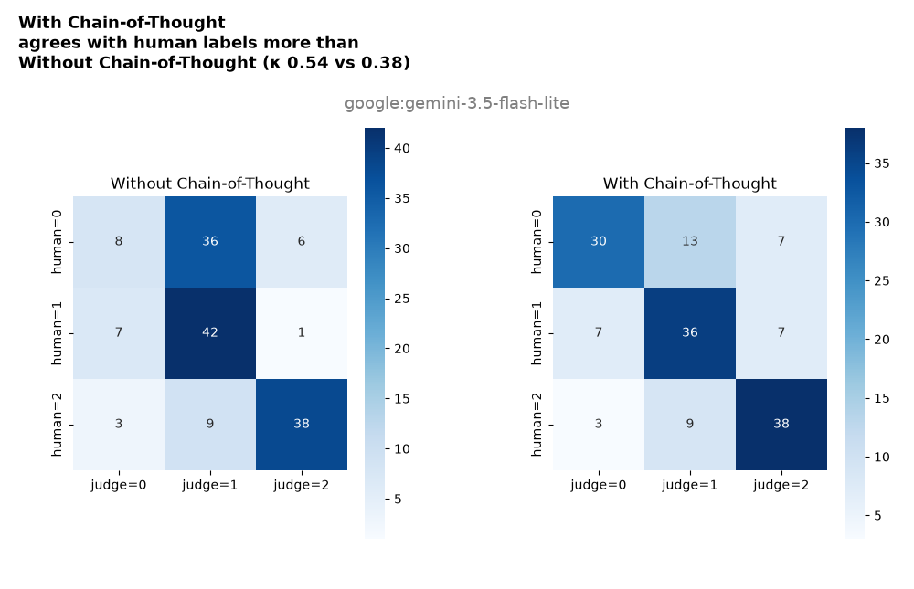

# judge-audit

*Meta-evaluation of LLM judges: measuring judge/human agreement and where judges miss.*

## Headline Finding
Chain-of-thought (CoT) grading caught **28 of 50** contradictions, up from **13** (class 0 recall 0.26 to 0.56, $p=0.0002$, $n=150$), with no detectable precision cost (0.72 to 0.76).

**Key caveat:** The CoT rubric checks claims one by one, the same way the ground-truth labels were built. Part of the gain may be format match, not better reasoning. Scope: single judge model, one dataset.



**Status:** 1 experiment complete. Next: position, verbosity, and self-preference bias. [Roadmap](docs/research.md) 

## Motivation
Evaluating generative model outputs via LLM judges is increasingly common, but relying on unvalidated AI-as-judge models is risky. This harness enables rapid, statistically grounded experiments comparing LLM judge configurations against high-quality human consensus labels (from [RAGTruth](experiments/ragtruth/ragtruth.md)).

The codebase is built for flexibility across datasets, metrics, and models. See [engineering choices](docs/tastes.md#engineering-taste) for architectural principles.

For a full listing of completed and planned experiments, see [Research](docs/research.md).

This repo was built interactively with Claude Code with project-specific conventions in `CLAUDE.md`.

## Getting Started

**Just want to see the results?** The dataset, scored results, and figures are already committed. Start with [`docs/research.md`](docs/research.md) or browse [`experiments/ragtruth/01-strict-vs-cot-rubric/figures/`](experiments/ragtruth/01-strict-vs-cot-rubric/figures). No setup needed.

**Want to run it yourself?**

1. Install [Docker](https://docs.docker.com/get-docker/) and make sure it's running.
2. Clone the repo and `cd` into it.
3. Copy `.env.example` to `.env` and add a `GOOGLE_API_KEY` (the only provider currently active in the experiment's `promptfooconfig.yaml`).
4. `make docker-build` to build the image.
5. `make docker-eval` to run the judge evaluations. This calls a real API and spends money.
6. `make docker-analyze` to extract scores and compute agreement metrics. Free, local only.
7. `make docker-view` to browse eval history in the browser, or open the experiment's `agreement_summary.csv` and `figures/` directly.

`make docker-run` chains prepare, eval, and analyze in one command if you want the whole pipeline at once (also spends money on the eval step). See [`CLAUDE.md`](CLAUDE.md) for the full set of commands.

<details>
<summary><b>Project structure</b></summary>

```
judge-audit/
├── CLAUDE.md                    # working conventions for this repo
├── Dockerfile
├── docker-compose.yml
├── Makefile                     # every workflow entry point
├── requirements.txt             # pinned Python dependencies
├── .claude/settings.json        # tool permissions + config-validation hook
├── configs/
│   └── prompts/                 # rubric prompts, shared across experiments
│       ├── rubric_v1_strict.txt
│       └── rubric_v2_chain_of_thought.txt
├── data/processed/
│   └── source_groundedness_150.csv # the 150-item hand-labeled dataset
├── docs/
│   ├── research.md              # index of hypotheses tested, links to each experiment
│   ├── approaches.md            # how each part of the tooling works
│   ├── tastes.md                # research/engineering taste notes
│   ├── llm-as-judge.md          # background reference on LLM-as-judge as a technique
│   ├── agreement-metrics.md     # background reference on judge/human agreement statistics
│   ├── industry-relevance.md    # why judge evaluation matters commercially, and how to reuse this approach
│   ├── worklog.md               # session-by-session activity log with costs
│   └── learnings.md             # technical and scientific learnings
├── experiments/
│   └── ragtruth/
│       ├── ragtruth.md          # RAGTruth dataset description
│       ├── 01-strict-vs-cot-rubric/
│       │   ├── README.md             # this experiment's hypothesis, methodology, and findings
│       │   ├── promptfooconfig.yaml  # this experiment's judge eval orchestration
│       │   ├── scored_results.csv    # per-item judge vs. human scores
│       │   ├── agreement_summary.csv # kappa/QWK/agreement per condition
│       │   └── figures/              # confusion-matrix heatmaps
│       └── 02-verbosity-bias/
│           └── README.md             # planned: verbosity bias probe
├── scripts/
│   ├── prepare_dataset.py       # RAGTruth -> 150-item CSV
│   ├── extract_scores.py        # results.json -> scored_results.csv
│   └── compute_agreement.py     # scored_results.csv -> metrics + figures
├── src/
│   ├── extractors.py            # judge output -> 0/1/2 score
│   ├── metrics.py               # Cohen's kappa, QWK, confusion matrix
│   ├── significance.py          # paired bootstrap CIs and p-values
│   └── visualization.py         # heatmap rendering
└── tests/                       # one file per src/scripts module
```

Note: each experiment's `results.json` (raw Promptfoo output) and `.promptfoo/` (eval history/cache) are generated locally by `make docker-eval` but git-ignored, so they won't appear after a fresh clone.

</details>

## Documentation

Deeper documentation, organized by purpose:

### Research
- [Research](docs/research.md): Index of hypotheses tested, linking out to each experiment's own write-up.
- [Research Taste and Engineering Taste](docs/tastes.md): Judgments and principles behind the decisions in this repo.
- [Agreement Metrics](docs/agreement-metrics.md): Background on the statistics used to measure judge/human agreement, including ones considered but not used.

### Background
- [Industry Relevance](docs/industry-relevance.md): Why judge evaluation is a commercial problem, not just a research one, and how this repo's approach could be reused for a production judge.
- [LLM-as-Judge](docs/llm-as-judge.md): Background on LLM-as-judge as a technique, and how the tasks it's commonly used for relate to the calibration problem this project studies.

### Engineering
- [Technologies](docs/approaches.md): Why each technology was chosen and how it is used in this repo (Promptfoo, Docker, Python libraries).
- [Worklog](docs/worklog.md): Session-by-session activity log with costs and learnings.
- [CLAUDE.md](CLAUDE.md): Conventions for this repo.
