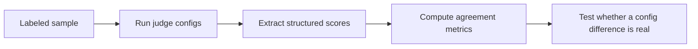

# Industry Relevance

Meta-evaluation (measuring the judge's agreement with human labels) is what stops an LLM-as-judge from failing silently once it drives a production workflow. A judge that was never validated can carry position bias, verbosity bias, or a class-specific blind spot into every score it produces, with nothing in the pipeline to flag it.

- Core techniques: [`llm-as-judge.md`](llm-as-judge.md).
- This repo's tooling: [`approaches.md`](approaches.md).

## Why judge evaluation matters for platforms and products

- **Content moderation and trust & safety.** A judge scoring harmlessness at scale stands in for reviewers who can't see every post. A blind spot fails silently: harmful content passes, or legitimate content is over-flagged, at whatever rate the blind spot occurs, with nobody watching.
- **RLHF and reward modeling.** A biased reward model or judge (position, verbosity, self-preference) bakes that bias into the trained policy's behavior. The error compounds across training instead of staying contained to one mis-scored item.
- **Automated QA and regression monitoring.** "The judge didn't flag anything" equals "no regression" only if the judge's agreement with human judgment has been measured. Treating them as the same claim without that measurement is the gap this project addresses.
- **Vendor and procurement risk.** Adopting a third-party judge/eval API means trusting the vendor's accuracy claims. Meta-evaluation checks that claim against your own traffic and your own definition of a costly error, not a vendor benchmark.
- **Cost pressure.** LLM-as-judge is adopted because it is cheaper than human review at scale. That same cost gap lets a bad judge go unnoticed longer, because nobody is running the expensive human review that would catch it. Validation matters more under cost pressure, not less.

## Reusing this repo's approach

The pipeline is generic. Nothing in it is specific to RAGTruth or source-groundedness.

What changes per use case:

- **Dataset.** Swap [`data/processed/source_groundedness_150.csv`](../data/processed/source_groundedness_150.csv) for your own labeled production items. [`scripts/prepare_dataset.py`](../scripts/prepare_dataset.py) shows the required shape: a `context`/`response` pair plus a human label column.
- **Criterion structure.** The judgment structure (absolute ordinal score, binary classification, pairwise preference), not the criterion's name, decides which metrics apply. See [`agreement-metrics.md`](agreement-metrics.md#judgment-structure-determines-metric-choice-not-the-dimension).
- **Rubrics being compared.** [`configs/prompts/`](../configs/prompts/) holds plain text files. A new scoring prompt is a new file plus a line in the experiment's `promptfooconfig.yaml`, no code change.
- **Provider.** Providers are toggled one line at a time in `promptfooconfig.yaml` (see [`approaches.md`](approaches.md#promptfoo)). Testing a candidate judge model is a config edit, not a code change.
- **Safety-critical class.** [`src/metrics.py`](../src/metrics.py)'s `recall_class_0`/`precision_class_0` pattern generalizes: pick the class whose false negative is the worst-case outcome (a missed policy violation, a missed hallucination) and report recall on that class specifically, not just an aggregate agreement number that hides it.
- **Unchanged:** Docker/Makefile reproducibility, the cost-aware permission split (free steps auto-run, paid API calls confirm first), and the [paired bootstrap significance test](../src/significance.py). See [`tastes.md`](tastes.md#reproducibility--velocity-in-practice).

## What would need to change for a production setting

This repo is a batch, offline harness: one manual run against a static 150-item sample. Adopting the pattern for a live judge needs more than a dataset swap.

- **Larger, continuously refreshed sample.** 150 items gave a confidence interval wide enough that one of three metrics missed significance. A ship decision needs a tighter interval and a sample refreshed as traffic and failure modes shift.
- **A re-validation trigger.** A judge that passes today can degrade silently after a provider-side model update, a prompt change, or a traffic shift. Meta-evaluation has to re-run on a schedule or a trigger (new model version, detected distribution shift), not once.
- **An adjudication process for disagreement.** This repo treats the human label as ground truth throughout. A live system needs a defined process for judge-vs-human disagreement on real, safety- or money-consequential cases, not just a downstream statistic.
- **Monitoring the judge's own drift.** The [workflow in `llm-as-judge.md`](llm-as-judge.md#example-workflow) treats meta-evaluation as a pre-deployment gate. Production needs that same check running continuously against the judge itself, which drifts like anything it scores.
