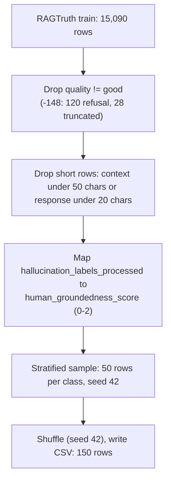

# Experiment 1: Strict vs. Chain-of-Thought Judge Rubric

## AI Safety Relevance

LLM judges feed red-teaming, benchmarks, RLHF signal, production monitoring: judge bias propagates downstream. Meta-evaluation (judge/human agreement on a labeled sample) is the trust check. This experiment is one, on hallucination detection.

## Finding

**Chain-of-thought (CoT) prompting more than doubles the judge's catch rate on contradictions.** Making the judge list each factual claim and check it against the source before scoring, rather than scoring in one shot, raised Ungrounded recall 0.26 to 0.56 (p=0.0002): 13/50 contradictions caught, up to 28/50. Precision held (0.72 to 0.76): real catches, not indiscriminate flagging.

Cohen's κ and exact agreement improve significantly; quadratic weighted κ (QWK) does not. Scope: single model (`google:gemini-3.5-flash-lite`), n=150.

## Purpose

**Dry-run the evaluation pipeline** ($n=150$) end to end.

**Key risk:** CoT rubric mirrors ground-truth label structure. Gains may reflect format alignment, not reasoning. Isolating reasoning requires a non-matching prompt or human re-rating.

## Research Question

Does chain-of-thought in a judge prompt change judge/human agreement vs. a strict, direct-scoring rubric?

- **H0:** no difference.
- **H1:** CoT improves agreement.

## Setup

- **Judge model:** `google:gemini-3.5-flash-lite`.
- **Data:** RAGTruth ([`ragtruth.md`](../ragtruth.md)).
- **Both prompts:** same inputs (source passages, response), 0-2 scale, JSON output (score, one-sentence justification).
- **Strict** ([`rubric_v1_strict.txt`](../../../configs/prompts/rubric_v1_strict.txt)): direct score, no intermediate reasoning.
- **CoT** ([`rubric_v2_chain_of_thought.txt`](../../../configs/prompts/rubric_v2_chain_of_thought.txt)): list claims, mark supported/unsupported/contradicted, then score.
- **Isolated variable:** scoring instruction only. Same model, scale, items, format.

### Data Processing

`scripts/prepare_dataset.py`, RAGTruth `train` split, output [150 rows](../../../data/processed/source_groundedness_150.csv).

- **Used:** `context`, `output` (renamed `response`), `hallucination_labels_processed`, `quality` (filter only).
- **Dropped:** `task_type`, `model`, `temperature`, `hallucination_labels`.
- **Quality filter, why:** refusals and truncations have no hallucination spans, so they score "Fully Grounded" unevaluated. 148/15,090 dropped, margin intact.
- **Length filter:** removes degenerate rows pre-sampling.
- **Score mapping** (from `evident_conflict`/`baseless_info` span counts):
  - `2` Fully Grounded: neither kind present
  - `1` Partially Grounded: `baseless_info` only
  - `0` Ungrounded: any `evident_conflict`
- **Written:** `context`, `response`, `human_groundedness_score`.

### Weakness: label derivation isn't a human holistic rating

- **Label is a rule, not a rating:** collapsing rule over span counts, not a human scoring 0-2.
- **Input mismatch:** judge sees raw context and response, no spans or counts.
- **Disagreement is ambiguous:** a miss may be judge error or differing severity bucketing (1 baseless span and 15 both collapse to `1`).
- **Consequence:** treat κ as a lower bound. No human holistic re-rating yet.

## Results: Strict vs. Chain-of-Thought

Same 150 items under both rubrics.

### Overall agreement

| Rubric | Cohen's κ | Quadratic Weighted κ | Exact agreement | Parse failures |
|---|---|---|---|---|
| Without Chain-of-Thought | 0.40 | 0.53 | 60.0% | 0/150 |
| With Chain-of-Thought | **0.53** | **0.60** | **68.7%** | 0/150 |

Post-quality-filter (see [Data Processing](#data-processing), correction note below).

### Class 0 (Ungrounded) recall and precision

Those metrics treat classes symmetrically. Worst failure mode for hallucination detection: a missed contradiction. Isolated by [`src/metrics.py`](../../../src/metrics.py) (`recall_class_0`/`precision_class_0`):

| Rubric | Recall (class 0) | Precision (class 0) |
|---|---|---|
| Without Chain-of-Thought | 0.26 | 0.72 |
| With Chain-of-Thought | **0.56** | 0.76 |

### Statistical significance

Paired bootstrap, 10,000 resamples ([`src/significance.py`](../../../src/significance.py)):

| Metric | Observed diff (CoT − strict) | 95% CI | p-value | Significant at α=0.05? |
|---|---|---|---|---|
| Cohen's κ | +0.13 | [0.02, 0.24] | 0.027 | **Yes** |
| Quadratic Weighted κ | +0.07 | [-0.03, 0.17] | 0.166 | No |
| Exact agreement rate | +0.087 | [0.007, 0.167] | 0.040 | **Yes** |
| Recall (class 0) | +0.30 | [0.15, 0.45] | **0.0002** | **Yes** |
| Precision (class 0) | +0.035 | [-0.20, 0.28] | 0.801 | No |

### Interpretation

- **Headline:** class 0 recall more than doubled (0.26 to 0.56, p=0.0002). Over twice as many real contradictions caught.
- **No precision cost:** 0.72 to 0.76 (p=0.80). Real detections, not indiscriminate flagging.
- **Significant:** Cohen's κ, exact agreement, class 0 recall. **Not:** QWK, class 0 precision (CIs cross zero).
- **Confusion matrix, human=0:** strict 13/50 (31 misread as `1`), CoT 28/50. Human=2 close: 37/50 vs 40/50.
- **QWK lags:** remaining errors are off-by-one, concentrated at the 0-vs-1 boundary; QWK penalizes far misses.
- **H1 supported** for unweighted agreement and contradiction detection, not for QWK.

### Caveats

- **CoT structure matches label construction.** CoT categorizes claims span-by-span, as the label was built; strict gives one holistic guess. Part of the κ gain may be that match. Not separable here.
- **Data processing correction.** Original run lacked the `quality` filter. After re-sampling: κ 0.38 to 0.40 (strict), 0.54 to 0.53 (CoT), within noise at n=150. Finding unchanged.
- **Provider.** `google:gemini-3.7-flash` hit frequent `503 UNAVAILABLE` and ran slowly; switched to `gemini-3.5-flash-lite`, which may understate a stronger model.

## Weaknesses of Experiment

- **Single model.** One judge, one comparison. Model-specific, not a general CoT claim.
- **Size confound.** Small/fast tiers plausibly gain more from reasoning scaffolding. Gap may shrink on a stronger judge.
- **One wording per condition.** Phrasing is an independent lever. Measures these two prompts, not CoT-style vs. strict-style generally.
- **Metric-dependent.** QWK and class 0 precision miss significance at n=150.
- **One dataset, one domain, English only.** No evidence of transfer (medical, legal RAG).
- **No held-out replication.** RAGTruth `test` split (2,700 rows, untouched) is the natural check.
- See [Annotation Methodology](../ragtruth.md#annotation-methodology) for unaddressed sample limits.

## Future Experiments

Roadmap of untested hypotheses (multi-provider comparison, bias probes): [`docs/research.md`](../../../docs/research.md).
