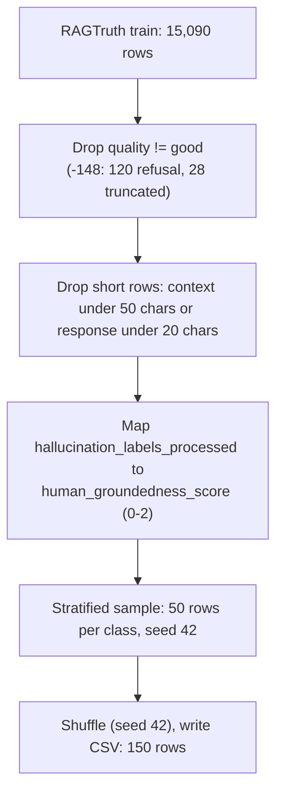

# Experiment 1

**Finding:** adding chain-of-thought to the judge prompt more than doubles recall on the Ungrounded class (0.26 → 0.56, p=0.0002) with no significant precision cost. Cohen's κ and exact agreement also improve significantly; QWK does not. Single model (`google:gemini-3.5-flash-lite`), n=150.

## AI Safety Relevance

- LLM judges feed red-teaming pipelines, capability benchmarks, RLHF training-signal generation, and production monitoring. A biased judge propagates that bias into every downstream use.
- Meta-evaluation (measuring judge/human agreement on a labeled sample) is the check that the judge's grading is trustworthy for your data. This experiment is one such check.

## Research Question

Does asking for chain-of-thought reasoning in a judge prompt change how well the judge agrees with human labels, compared to a strict, direct-scoring rubric with no reasoning steps first?

- **H0:** CoT reasoning makes no difference to judge/human agreement.
- **H1:** CoT reasoning improves judge/human agreement over a strict, direct-scoring rubric.

## Setup

- **Judge model:** one provider, `google:gemini-3.5-flash-lite`.
- **Data:** RAGTruth (see [`ragtruth.md`](../ragtruth.md)).
- **Both prompts:** score on a 0-2 scale from the same inputs (source passages, LLM response); output a JSON object with score and one-sentence justification.
- **Prompt 1, strict** ([`rubric_v1_strict.txt`](../../../configs/prompts/rubric_v1_strict.txt)): score directly, no intermediate reasoning requested.
- **Prompt 2, CoT** ([`rubric_v2_chain_of_thought.txt`](../../../configs/prompts/rubric_v2_chain_of_thought.txt)): (1) list each factual claim, (2) mark each supported/unsupported/contradicted against the context, (3) score from that analysis.
- **Isolated variable:** the scoring instruction only. Same model, scale, items, output format, so results are attributable to that difference alone. The CoT rubric's claim-by-claim structure resembles how the ground-truth label was built (see [Caveat](#weakness-label-derivation-isnt-a-human-holistic-rating)).

### Data Processing

Built by `scripts/prepare_dataset.py` from the RAGTruth `train` split, producing [150 rows](../../../data/processed/source_groundedness_150.csv).

- **Columns used:** `context`, `output` (renamed `response`), `hallucination_labels_processed`, `quality` (filter only, not written out).
- **Columns dropped:** `task_type`, `model`, `temperature`, `hallucination_labels`.
- **Quality filter, why:** a refusal or truncated generation has no hallucination spans, so without this filter it scores as "Fully Grounded" despite never being evaluated for groundedness. Dropping 148/15,090 still leaves margin for 50 rows per class.
- **Length filter:** removes empty/degenerate rows before sampling.
- **`human_groundedness_score` mapping** (from `evident_conflict`/`baseless_info` span counts):
  - `2` Fully Grounded: no spans of either kind
  - `1` Partially Grounded: `baseless_info` present, no `evident_conflict`
  - `0` Ungrounded: `evident_conflict` present, regardless of `baseless_info` count
- **Final columns written:** `context`, `response`, `human_groundedness_score`, the three fields the judge prompts and scoring scripts need.

### Weakness: label derivation isn't a human holistic rating

- **The ground-truth label is a rule, not a rating.** `human_groundedness_score` is a collapsing rule over aggregated `evident_conflict`/`baseless_info` span counts, not a human directly scoring a response 0-2.
- **The judge and the label see different inputs.** The judge scores from raw context and response with no visibility into spans or counts.
- **Disagreement is ambiguous.** A confusion-matrix miss could be a genuine judge error, or the judge and the rule bucketing severity differently (1 baseless-info span and 15 both collapse to `1`; a judge reading raw text has no reason to treat them as equally grounded).
- **Consequence:** read the κ scores below as a lower bound on judge quality, not a clean measure. Not yet validated against a human re-rating a sample holistically.

## Results: Strict rubric vs. chain-of-thought rubric

`rubric_v1_strict` (score only) vs. `rubric_v2_chain_of_thought` (claim analysis before scoring), same 150 items under both.

### Overall agreement

| Rubric | Cohen's κ | Quadratic Weighted κ | Exact agreement | Parse failures |
|---|---|---|---|---|
| Without Chain-of-Thought | 0.40 | 0.53 | 60.0% | 0/150 |
| With Chain-of-Thought | **0.53** | **0.60** | **68.7%** | 0/150 |

Numbers are post-quality-filter (see [Data Processing](#data-processing) and the correction note below).

### Class 0 (Ungrounded) recall and precision

The three metrics above treat all classes symmetrically. For a hallucination-detection judge, a false negative on class 0 (a missed contradiction) is the worst failure mode. [`src/metrics.py`](../../../src/metrics.py)'s `recall_class_0`/`precision_class_0` isolate it:

| Rubric | Recall (class 0) | Precision (class 0) |
|---|---|---|
| Without Chain-of-Thought | 0.26 | 0.72 |
| With Chain-of-Thought | **0.56** | 0.76 |

### Statistical significance

Point estimates can't say whether the gap exceeds sampling noise at n=150. Paired bootstrap, 10,000 resamples ([`src/significance.py`](../../../src/significance.py)):

| Metric | Observed diff (CoT − strict) | 95% CI | p-value | Significant at α=0.05? |
|---|---|---|---|---|
| Cohen's κ | +0.13 | [0.02, 0.24] | 0.027 | **Yes** |
| Quadratic Weighted κ | +0.07 | [-0.03, 0.17] | 0.166 | No |
| Exact agreement rate | +0.087 | [0.007, 0.167] | 0.040 | **Yes** |
| Recall (class 0) | +0.30 | [0.15, 0.45] | **0.0002** | **Yes** |
| Precision (class 0) | +0.035 | [-0.20, 0.28] | 0.801 | No |

### Interpretation

- CoT improved every metric as a point estimate; the effects are not uniform.
- **Headline result:** class 0 recall more than doubled (0.26 → 0.56, p=0.0002). The CoT rubric catches over twice as many real contradictions.
- **No precision cost:** class 0 precision barely moved (0.72 → 0.76, p=0.80). CoT is finding real contradictions, not flagging "Ungrounded" indiscriminately.
- **Significant:** Cohen's κ, exact agreement, class 0 recall. **Not significant:** QWK (CI crosses zero), class 0 precision.
- **Confusion matrix, human=0 row:** strict catches 13/50, misclassifying 31 as "partially grounded" (1); CoT catches 28/50. Human=2 row is close (37/50 vs 40/50).
- **Why QWK lags:** most remaining errors on both rubrics are off by one point, not two, and QWK penalizes far-miss errors more. The improvement is concentrated at the 0-vs-1 boundary.
- **H1** is supported for unweighted agreement and, most strongly, for catching real contradictions; not conclusively for QWK.

### Caveats

- **CoT structure matches the label's construction.** `rubric_v2_chain_of_thought` categorizes claims span-by-span, as the ground-truth label was built; `rubric_v1_strict` gives one holistic guess. Part of the κ gain may be that match, not CoT reasoning being generally better. This experiment can't separate the two; see [label-derivation weakness](#weakness-label-derivation-isnt-a-human-holistic-rating).
- **Data processing correction.** The original run didn't filter `quality` (see [Data Processing](#data-processing)), so a few refusals/truncated generations were misclassified as "Fully Grounded". After filtering and re-sampling, κ moved 0.38 → 0.40 (strict) and 0.54 → 0.53 (CoT), within sampling noise for n=150. The finding is unchanged.
- **Provider.** An earlier attempt on `google:gemini-3.7-flash` hit frequent `503 UNAVAILABLE` errors and ran slowly; the project switched to `gemini-3.5-flash-lite`, a smaller/faster tier that may understate a stronger model (see [Weaknesses](#weaknesses-of-experiment)).

## Weaknesses of Experiment

Beyond the label-derivation and CoT-vs-label-construction caveats above:

- **Single model.** One judge (`google:gemini-3.5-flash-lite`), one comparison. A specific finding about that model, not a general claim about CoT prompting for LLM judges.
- **Model size confounds the effect.** A small/fast tier plausibly benefits more from reasoning scaffolding than a larger model that reasons adequately in one shot. The gap could shrink or vanish on a stronger judge.
- **One rubric wording per condition.** Prompt phrasing is a large lever independent of the CoT distinction. This measures these two specific prompts, not CoT-style vs. strict-style instructions as strategies.
- **Metric-dependent.** Cohen's κ, exact agreement, and class 0 recall clear significance at n=150; QWK and class 0 precision do not.
- **One dataset, one domain, English only.** RAGTruth's task types (QA, Summary, Data2txt) and label rule are corpus-specific. No evidence the effect transfers to another groundedness dataset or domain (medical, legal RAG).
- **No held-out replication.** The RAGTruth `test` split (2,700 rows, untouched, see [`ragtruth.md`](../ragtruth.md)) is the natural place to check replication on fresh data.
- See [Annotation Methodology](../ragtruth.md#annotation-methodology) for sample limitations not yet addressed (label collapsing, no direct human holistic re-rating).

## Future Experiments

- See [`docs/research.md`](../../../docs/research.md) for the project-wide roadmap of hypotheses not yet tested (multi-provider comparison, bias probes).
