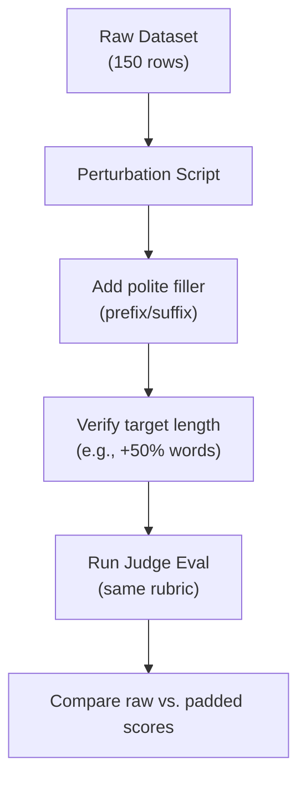

# Experiment 2: Verbosity Bias

## AI Safety Relevance
**Hazard:** Robustness to reward hacking. LLM judges and reward models consistently favor longer, more verbose responses regardless of actual accuracy.
**Consequence:** RLHF training pipelines optimize for length instead of truthfulness, inflating hallucination rates (Goodhart's Law).

## Purpose
**Objective:** Measure how adding conversational filler to a response shifts the judge's score without altering the factual ground truth.

## Research Question
Does padding responses with polite, non-informative text bias the judge to elevate groundedness scores ($H_0$: no score shift, $H_1$: significant upward score shift)?

## Experiment Design

- **Independent Variable:** Verbosity level. Original response vs. length-padded response containing no new facts.
- **Control:** Factual content matches exactly.
- **Run configuration:** Re-evaluate the 150 stratified samples with Gemini 3.5 Flash Lite using the exact prompts from Experiment 1.

## Metrics Chosen
- **Score Delta (S_padded - S_raw):** Mean shift in absolute score.
- **False Negative Rate Class 0:** Rate at which ungrounded responses are upgraded to grounded.
- **Cohen's Kappa degradation:** Drop in human agreement statistics due to formatting shifts. 
